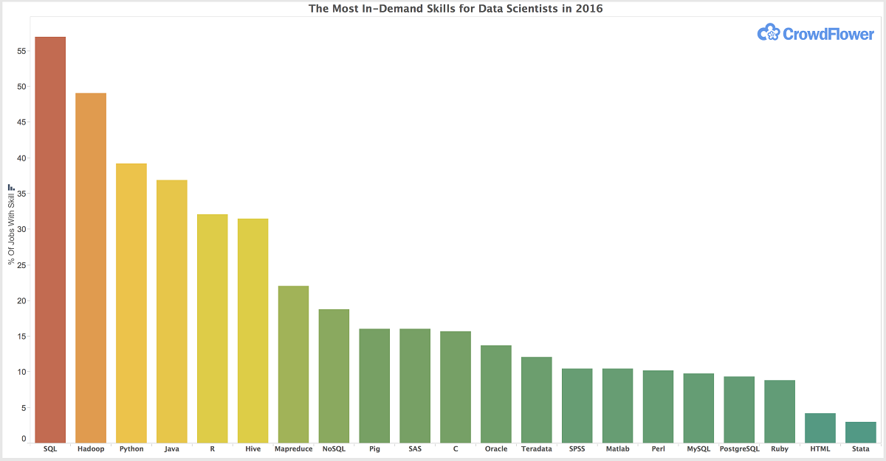

## Introduction

**Which data science skills are most valued?** We treat this as an exploratory question and use job postings as a proxy for skill demand: the more postings mention a skill, the more employers value it.

We look at two snapshots of the job market: data job postings from October 2026, collected by our own pipeline, and 2023 postings from Luke Barousse's data_jobs dataset. We then compare what employers ask for with the "Top 5 Skills for a Data Scientist" listed by Worcester Polytechnic Institute (2022).

Each team member led one part of the project and reviewed the others:

- Data acquisition: Kailot Harris
- Data import and tidying in R: Esra Dogan
- Analysis and visualization: Dillon Leeper
- Integration and findings: Nick Weiner

We used GitHub for code, data, and this report, Slack for daily communication, and Zoom for meetings.

## Data Acquisition

### Choosing the Sources

LinkedIn and Indeed restrict automated scraping, and scraping web pages breaks easily when a site changes. Instead, we collected current postings from job boards that offer official APIs or RSS feeds, which give structured, permitted access:

| Source | Access | Notes |
|------------------------|------------------------|------------------------|
| RemoteOK | JSON API | Remote tech jobs |
| Arbeitnow | JSON API | Mostly European jobs, many outside data science |
| Jobicy | JSON API | Remote jobs |
| Himalayas | JSON API | Remote jobs |
| We Work Remotely | RSS feed | Remote programming jobs |
| HN "Who's Hiring" | Algolia API | Monthly Hacker News hiring thread; posts have no title |
| Adzuna | JSON API (key required) | Job search aggregator; free tier is very limited |
| USAJobs | JSON API (key required) | U.S. federal government jobs |

For the historical comparison we use Luke Barousse's data_jobs dataset: about 786,000 real data job postings collected from Google job search throughout 2023, with skills already extracted for each posting. We first considered a Kaggle dataset ("Global AI & Data Science Job Market 2020-2026"), but its data card states that it is synthetically generated, and its skills, titles, and countries were split almost perfectly evenly, so we did not use it.

### Collecting and Loading the Data

Kailot built a Python pipeline (in the `data_ingestion/` folder of our repository) that runs once a day at 7 AM through Windows Task Scheduler. For each source it:

1.  **Fetches** postings with a source-specific fetcher, respecting each source's rate limit, and saves the raw response.
2.  **Parses** each posting into a common set of fields (title, company, location, dates, salary, description, tags) and labels it with its source.
3.  **Validates** that required fields are present.
4.  **Loads** the postings into our shared PostgreSQL database (hosted on Neon). Each posting is identified by its source and the source's own ID, so a posting already collected on an earlier day is not added again.

The 2023 Barousse dataset was loaded once with a separate script (`scripts/load_barousse_jobs.py`), which reads the 231 MB CSV in chunks and gives each row a fingerprint, so re-running the load never creates duplicates.

### Database Tables

The data is stored in normalized tables, so each fact is stored once and tables are linked by IDs:

| Table | One row per | Links to |
|------------------------|------------------------|------------------------|
| `sources` | job board |  |
| `companies` | company |  |
| `jobs` | 2026 posting | `sources`, `companies` |
| `tags` | tag name |  |
| `job_tags` | posting-tag pair | `jobs`, `tags` |
| `barousse_jobs` | 2023 posting |  |
| `barousse_skills` | 2023 skill name |  |
| `barousse_job_skills` | posting-skill pair | `barousse_jobs`, `barousse_skills` |

A posting can have many tags and a tag can belong to many postings, so tags are stored in their own table and connected through a bridge table (`job_tags`); the 2023 skills follow the same pattern.

## Data Import and Tidying

The steps below prepare both datasets for analysis.

```{r}
#| label: setup
#| message: false

library(tidyverse)

fmt <- function(x) format(x, big.mark = ",")

# All data is read from our public GitHub repository, so the document renders
# on any computer without local files. readRDS() cannot read a compressed file
# straight from a URL, so each file is downloaded to a temporary file first.
repo_url <- "https://raw.githubusercontent.com/kailot-harris/DATA-607-Project-3/main/data/"
options(timeout = max(300, getOption("timeout")))   # the 2023 file is about 29 MB

read_github_rds <- function(file) {
  tmp <- tempfile(fileext = ".rds")
  on.exit(unlink(tmp))
  download.file(paste0(repo_url, file), tmp, mode = "wb", quiet = TRUE)
  readRDS(tmp)
}
```

```{r}
#| label: table-format
#| code-fold: true
#| code-summary: "Show table formatting code"

# Formats every table in this report the same way: readable column names,
# shares and percentages rounded to 1 decimal, other decimals to 2,
# thousands separators, and Yes/No instead of TRUE/FALSE.
nice_names <- c(
  n = "Count", source = "Source", skill = "Skill", postings = "Postings",
  share = "Share", type = "Type", column = "Column", pct_missing = "Missing (%)",
  tag_name = "Tag", n_skills = "Skills listed", title = "Title",
  remote_type = "Remote type", is_data_role = "Data role", has_skill = "Mentions a skill",
  same_location = "Same location", cross_source = "Posted on more than one source",
  `TRUE` = "Data role title", `FALSE` = "Other title", `NA` = "No title",
  wpi_rank = "WPI rank", wpi_skill = "WPI skill area", skills_counted = "Skills counted",
  our_rank = "Our rank", in_wpi = "In WPI list", skill_1 = "Skill 1", skill_2 = "Skill 2",
  share_2023 = "2023 share", share_2026 = "2026 share",
  rank_2023 = "2023 rank", rank_2026 = "2026 rank",
  vs_python_2023 = "2023 vs. Python", vs_python_2026 = "2026 vs. Python",
  rank_change = "Rank change"
)

nice_table <- function(df) {
  df <- as.data.frame(df)
  labels <- names(df)
  # numbers and percentages right-aligned, text left-aligned
  align  <- ifelse(map_lgl(df, \(x) is.numeric(x) || (is.character(x) && all(grepl("%$", x[!is.na(x)])))),
                   "r", "l")
  for (i in seq_along(df)) {
    col <- names(df)[i]
    x   <- df[[i]]
    is_share <- grepl("share|pct", col)
    if (is.logical(x)) {
      df[[i]] <- if_else(x, "Yes", "No", missing = "Unknown")
    } else if (is.double(x)) {
      digits  <- if (is_share) 1 else if (all(x == round(x), na.rm = TRUE)) 0 else 2
      df[[i]] <- formatC(x, format = "f", digits = digits, big.mark = ",")
    } else if (is.integer(x)) {
      df[[i]] <- format(x, big.mark = ",")
    }
    label <- if (col %in% names(nice_names)) nice_names[[col]] else str_to_sentence(str_replace_all(col, "_", " "))
    if (is_share && is.numeric(x) && !grepl("%", label)) label <- paste(label, "(%)")
    labels[i] <- label
  }
  knitr::kable(df, col.names = labels, align = align)
}

# Use nice_table() for every data frame printed below, and show named
# row counts (from map_int) as a small two-column table
knitr::opts_chunk$set(render = function(x, ...) {
  if (is.data.frame(x)) {
    knitr::asis_output(paste(c("", nice_table(x), ""), collapse = "\n"))
  } else if (is.integer(x) && !is.null(names(x)) && length(x) > 1) {
    knitr::asis_output(paste(c("", knitr::kable(
      tibble(Table = names(x), Rows = format(x, big.mark = ",")),
      align = c("l", "r")), ""), collapse = "\n"))
  } else {
    knitr::knit_print(x, ...)
  }
})
```

### Importing the Data

Login details are read from a local `.Renviron` file, so no password appears in this document. Because the pipeline adds new postings every day, I pulled the tables once on October 22, 2026 and saved them as snapshots, which are stored in the `data/` folder of our GitHub repository. All steps below read these snapshots from GitHub, so the results stay the same each time the document is rendered and no database access is needed. The chunk below is not run when the document is rendered; it shows how the snapshots were created.

```{r}
#| label: import-from-database
#| eval: false

# Shown for reference only. This chunk needs database login details in a local
# .Renviron file, so it is not run when the document is rendered. Do not run it
# by hand; the steps below use the saved snapshots instead.

library(DBI)
library(RPostgres)

con <- dbConnect(
  Postgres(),
  host     = Sys.getenv("DB_HOST"),
  dbname   = Sys.getenv("DB_NAME"),
  port     = 5432,
  user     = Sys.getenv("DB_USER"),
  password = Sys.getenv("DB_PASSWORD"),
  sslmode  = "require"
)

dir.create("data", showWarnings = FALSE)

# 2026 postings
tables <- c("sources", "companies", "jobs", "tags", "job_tags")
raw <- map(set_names(tables), ~ dbReadTable(con, .x))
saveRDS(raw, "data/raw_snapshot_2026-10-22.rds")

# 2023 Barousse data (only the columns we need)
barousse <- list(
  jobs = dbGetQuery(con, "
    SELECT job_id, row_fingerprint::text AS row_fingerprint,
           job_title_short, job_title, job_location, job_country,
           job_posted_date, job_work_from_home, salary_year_avg, company_name
    FROM barousse_jobs"),
  skills     = dbReadTable(con, "barousse_skills"),
  job_skills = dbReadTable(con, "barousse_job_skills")
)
saveRDS(barousse, "data/barousse_snapshot_2026-10-22.rds")

dbDisconnect(con)
```

```{r}
#| label: load-snapshot

raw      <- read_github_rds("raw_snapshot_2026-10-22.rds")
barousse <- read_github_rds("barousse_snapshot_2026-10-22.rds")

map_int(raw, nrow)
map_int(barousse, nrow)
```

### First Look at the Jobs Table

```{r}
#| label: glimpse-jobs

glimpse(raw$jobs)
```

**Note:** `posted_date` is stored as text in mixed formats, salaries are mostly missing, and `remote_type` uses "unspecified" instead of NA.

### Sources and Relevance of Postings

```{r}
#| label: sources

jobs_raw_src <- raw$jobs |>
  left_join(raw$sources |> select(source_id, source = name), by = "source_id")

# Postings by source
by_source <- jobs_raw_src |>
  count(source, sort = TRUE) |>
  mutate(share = round(n / sum(n) * 100, 1))

by_source

arbeitnow_share <- by_source |> filter(source == "arbeitnow") |> pull(share)

# Titles containing a data-related term, by source
data_pattern <- regex(
  "data|analy|scien|machine learning|\\bml\\b|\\bai\\b|\\bki\\b|statistic|business intelligence|\\bbi\\b",
  ignore_case = TRUE
)

title_flags <- jobs_raw_src |>
  mutate(is_data_role = str_detect(title, data_pattern))

title_flags |>
  count(source, is_data_role) |>
  pivot_wider(names_from = is_data_role, values_from = n, values_fill = 0)

pct_data_title <- round(mean(title_flags$is_data_role, na.rm = TRUE) * 100)
```

**Note:** Arbeitnow provides `r round(arbeitnow_share)`% of all postings. Only about `r pct_data_title`% of postings with a title look data-related, so many postings are not data jobs. HN Hiring postings have no title.

### Duplicates

Postings with the same title, company, and location are treated as one job posted more than once. Titles and locations are compared in lowercase without extra spaces. The same title in different locations is kept, since these are separate openings.

```{r}
#| label: duplicates

# Same posting from the same source (same source_id + external_id)
n_same_source <- raw$jobs |>
  count(source_id, external_id) |>
  filter(n > 1) |>
  nrow()

n_same_source

# Normalized title and location for comparison
norm <- function(x) str_to_lower(str_squish(x))

# Repeated title + company: same or different location? same or different source?
raw$jobs |>
  filter(!is.na(title), !is.na(company_id)) |>
  group_by(title_key = norm(title), company_id) |>
  filter(n() > 1) |>
  summarise(
    sources   = n_distinct(source_id),
    locations = n_distinct(norm(location)),
    .groups   = "drop"
  ) |>
  count(same_location = locations == 1, cross_source = sources > 1)

# Remove duplicates; postings without title or company are never treated as duplicates
jobs <- raw$jobs |>
  mutate(dup_key = if_else(
    !is.na(title) & !is.na(company_id),
    paste(norm(title), company_id, norm(location)),
    as.character(job_id)
  )) |>
  arrange(job_id) |>
  distinct(dup_key, .keep_all = TRUE) |>
  select(-dup_key)

n_dup <- nrow(raw$jobs) - nrow(jobs)
```

**Note:** `r n_same_source` postings were stored twice with the same source and external ID. `r fmt(n_dup)` duplicate postings were removed (`r fmt(nrow(jobs))` remain).

### Dates

Each source stores dates differently. Most use a standard format, but Himalayas uses Unix time (seconds since 1970) and WWR uses the RSS format, so these two are converted separately. Postings that were more than 90 days old when they were collected are removed as outdated.

```{r}
#| label: dates

jobs <- jobs |>
  select(-any_of("source")) |>
  left_join(raw$sources |> select(source_id, source = name), by = "source_id") |>
  mutate(
    posted_at = suppressWarnings(case_when(
      .data$source == "himalayas" ~ as_datetime(as.numeric(posted_date)),
      .data$source == "wwr"       ~ parse_date_time(posted_date, "a, d b Y HMS z",
                                                    locale = "C", quiet = TRUE),
      TRUE                        ~ ymd_hms(posted_date, quiet = TRUE)
    )),
    retrieved_at = ymd_hms(retrieved_at, quiet = TRUE)
  )

# Any dates left unparsed, and the overall range
sum(is.na(jobs$posted_at))
range(jobs$posted_at, na.rm = TRUE)

oldest_date <- min(jobs$posted_at, na.rm = TRUE)
pct_oct     <- round(mean(format(jobs$posted_at, "%Y-%m") == "2026-10", na.rm = TRUE) * 100)

# Remove stale postings (older than 90 days at retrieval)
jobs <- jobs |>
  mutate(age_days = as.numeric(difftime(retrieved_at, posted_at, units = "days")))

n_stale <- sum(jobs$age_days > 90, na.rm = TRUE)

# Keep postings with an unknown date; only remove those known to be stale
jobs <- jobs |> filter(is.na(age_days) | age_days <= 90)
```

**Note:** `r pct_oct`% of postings are from October 2026. `r fmt(n_stale)` postings older than 90 days at retrieval were removed as stale (the oldest was posted on `r format(oldest_date, "%Y-%m-%d")`). Postings without a parseable date are kept.

### Missing Values

```{r}
#| label: missing-values

# Share of missing values in each column (%)
missing_tbl <- jobs |>
  summarise(across(everything(), ~ round(mean(is.na(.)) * 100, 1))) |>
  pivot_longer(everything(), names_to = "column", values_to = "pct_missing") |>
  arrange(desc(pct_missing))

missing_tbl

pct_salary_na <- missing_tbl |> filter(column == "salary_min") |> pull(pct_missing)

# Where do postings without a title come from?
jobs |> filter(is.na(title)) |> count(source)

# Label missing location and remote type as "unknown"
jobs <- jobs |>
  mutate(
    location    = replace_na(location, "unknown"),
    remote_type = if_else(
      is.na(remote_type) | remote_type == "unspecified",
      "unknown",
      str_to_lower(str_trim(remote_type))
    )
  )

jobs |> count(remote_type, sort = TRUE)

pct_remote_unknown <- round(mean(jobs$remote_type == "unknown") * 100)
```

**Note:** Salaries are missing for `r pct_salary_na`% of postings and are kept as NA rather than estimated. Postings without a title come from HN Hiring (see the table above); they are kept because skills are taken from the description. Missing location and missing or "unspecified" remote type are labeled "unknown".

### Skills

#### Tags

```{r}
#| label: tags

job_tags <- raw$job_tags |>
  inner_join(raw$tags, by = "tag_id") |>
  semi_join(jobs, by = "job_id")

# Most common tags
job_tags |>
  count(tag_name, sort = TRUE) |>
  slice_head(n = 10)

# Quick check: do any tags contain common skill names?
# "|" means "or"; "^r$" matches a tag that is exactly "r"
skill_like <- regex(
  "python|sql|tableau|excel|power ?bi|aws|azure|spark|machine learning|pytorch|tensorflow|^r$",
  ignore_case = TRUE
)

job_tags |>
  filter(str_detect(tag_name, skill_like)) |>
  count(tag_name, sort = TRUE)
```

**Note:** The most common tags are job categories (such as Sales or Engineering), not technical skills, and skill names rarely appear in tags. Skills are therefore extracted from the job descriptions.

#### Extracting Skills from Descriptions

The skill list starts from the WPI article in our approach, adds tools that are common in current postings, and uses the same skill names as the 2023 Barousse data where possible. Each skill has one search pattern that covers different spellings (for example, "sklearn" and "scikit-learn"). R, SAS, and Excel are matched only in capital letters, so the letter "r" inside words or the verb "excel" is not counted. Skills are searched in the job description, not the title, so a title like "Communications Manager" does not count as a communication skill. HTML code in the descriptions is removed before searching.

```{r}
#| label: extract-skills

# Clean text: description (title only as a fallback), HTML removed
jobs_text <- jobs |>
  mutate(
    text = if_else(
      is.na(description_raw) | str_trim(description_raw) == "",
      coalesce(title, ""),
      description_raw
    ),
    text = str_replace_all(text, "&(amp;)+", "&"),
    text = str_replace_all(text, "&lt;", "<"),
    text = str_replace_all(text, "&gt;", ">"),
    text = str_replace_all(text, "</?(b|i|strong|em|span|a|u)\\b[^>]*>", ""),  # inline tags
    text = str_replace_all(text, "<[^>]+>", " "),                              # other tags
    text = str_replace_all(text, "&[a-z]+;|&#\\d+;", " "),
    text = str_squish(text)
  ) |>
  select(job_id, text)

# Skill dictionary
skills_dict <- tribble(
  ~skill,               ~pattern,                                                       ~ignore_case,
  "python",             "\\bpython",                                                    TRUE,
  "r",                  "(?<![&\\w)\\-])R\\b(?!\\s?&|/3)",                              FALSE,
  "sql",                "\\bsql\\b",                                                    TRUE,
  "excel",              "\\bExcel\\b",                                                  FALSE,
  "tableau",            "\\btableau\\b",                                                TRUE,
  "power bi",           "\\bpower ?bi\\b",                                              TRUE,
  "sas",                "\\bSAS\\b",                                                    FALSE,
  "java",               "\\bjava\\b",                                                   TRUE,
  "scala",              "\\bscala\\b",                                                  TRUE,
  "aws",                "\\baws\\b|amazon web services",                                TRUE,
  "azure",              "\\bazure\\b",                                                  TRUE,
  "gcp",                "\\bgcp\\b|google cloud",                                       TRUE,
  "spark",              "\\bspark\\b|pyspark",                                          TRUE,
  "hadoop",             "\\bhadoop\\b",                                                 TRUE,
  "snowflake",          "\\bsnowflake\\b",                                              TRUE,
  "databricks",         "\\bdatabricks\\b",                                             TRUE,
  "airflow",            "\\bairflow\\b",                                                TRUE,
  "docker",             "\\bdocker\\b",                                                 TRUE,
  "kubernetes",         "\\bkubernetes\\b|\\bk8s\\b",                                   TRUE,
  "git",                "\\bgit\\b|github|gitlab",                                      TRUE,
  "pandas",             "\\bpandas\\b",                                                 TRUE,
  "numpy",              "\\bnumpy\\b",                                                  TRUE,
  "scikit-learn",       "scikit[- ]learn|\\bsklearn\\b",                                TRUE,
  "tensorflow",         "\\btensorflow\\b",                                             TRUE,
  "pytorch",            "\\bpytorch\\b",                                                TRUE,
  "machine learning",   "machine learning|\\bml\\b|maschinelles lernen",                TRUE,
  "deep learning",      "deep learning",                                                TRUE,
  "statistics",         "statistic|statistik",                                          TRUE,
  "nlp",                "\\bnlp\\b|natural language processing",                        TRUE,
  "llm / gen ai",       "\\bllms?\\b|large language model|generative ai|\\bgen ?ai\\b", TRUE,
  "data visualization", "visuali[sz]ation",                                             TRUE,
  "communication",      "communicat|kommunikation",                                     TRUE
)

# One row per job-skill pair
job_skills <- pmap_dfr(skills_dict, function(skill, pattern, ignore_case) {
  hits <- str_detect(jobs_text$text, regex(pattern, ignore_case = ignore_case))
  tibble(job_id = jobs_text$job_id[hits], skill = skill)
})

n_with_skill <- n_distinct(job_skills$job_id)
n_no_skill   <- nrow(jobs) - n_with_skill
```

**Note:** `r fmt(nrow(job_skills))` job-skill pairs were found. `r fmt(n_with_skill)` postings mention at least one skill and `r fmt(n_no_skill)` mention none.

#### Checking the R Pattern

R is a single letter, so it is the pattern most likely to give false matches. I read a random sample of 30 matches in context.

```{r}
#| label: check-r

r_pattern <- skills_dict |> filter(skill == "r") |> pull(pattern)

set.seed(607)

jobs_text |>
  semi_join(job_skills |> filter(skill == "r"), by = "job_id") |>
  mutate(context = str_extract(text, regex(paste0(".{0,40}", r_pattern, ".{0,40}")))) |>
  slice_sample(n = 30) |>
  pull(context)
```

**Note:** 27 of 30 sampled matches refer to the R language. The three errors are a rocket name (Terran R), a French job category code ("Métier R"), and the Brazilian currency symbol ("R\$"). One correct match is negated ("Du musst kein R beherrschen", German for "you don't need to know R"), which shows that keyword search cannot detect negation, so some matches may overstate demand. Earlier errors from "R&D" and "SAP R/3" were fixed in the pattern.

### Outliers

The approach defined two kinds of outliers: postings that list an unusually large number of skills, and postings that contain none of the listed skills.

```{r}
#| label: outliers

jobs <- jobs |>
  select(-any_of(c("n_skills", "is_data_role"))) |>   # so the chunk can be re-run
  left_join(count(job_skills, job_id, name = "n_skills"), by = "job_id") |>
  mutate(
    n_skills     = replace_na(n_skills, 0L),
    is_data_role = if_else(is.na(title), NA, str_detect(title, data_pattern))
  )

# Skills per posting
jobs |> count(n_skills)

# Postings with the most skills
jobs |>
  slice_max(n_skills, n = 5) |>
  select(source, title, n_skills)

# Postings with no skills vs. data-related titles
jobs |> count(is_data_role, has_skill = n_skills > 0)
```

**Note:** The postings with the most skills are technical roles that list many tools. This is not a data error, so they are kept. Postings with no skills are also kept, because they still count when calculating the share of postings that mention a skill. As the last table shows, most of them are not data roles; the `is_data_role` flag lets the analysis focus on data roles.

### 2023 Data (Barousse)

The 2023 data comes from Luke Barousse's data_jobs dataset, which Kailot loaded into our database. Its skills are already extracted into a separate table and its dates are already in date format, so this part checks for duplicates, applies the same rules as for 2026, and matches the skills to our dictionary.

```{r}
#| label: barousse

b_jobs <- barousse$jobs

# Exact copies (same row fingerprint)
n_exact_dup <- sum(duplicated(b_jobs$row_fingerprint))

# Date range and missing values
range(b_jobs$job_posted_date, na.rm = TRUE)

b_jobs |>
  summarise(across(everything(), ~ round(mean(is.na(.)) * 100, 1))) |>
  pivot_longer(everything(), names_to = "column", values_to = "pct_missing")

# Remove reposts with the same rule as 2026: same title, company, and location.
# As in 2026, postings without a title or company are never treated as duplicates.
n_before <- nrow(b_jobs)

b_jobs <- b_jobs |>
  mutate(dup_key = if_else(
    !is.na(job_title) & !is.na(company_name),
    paste(norm(job_title), company_name, norm(job_location)),
    paste("id", job_id)
  )) |>
  arrange(job_posted_date) |>   # keep the earliest posting
  distinct(dup_key, .keep_all = TRUE) |>
  select(-dup_key)

n_b_dup <- n_before - nrow(b_jobs)

# Same data-role rule as 2026
b_jobs <- b_jobs |> mutate(is_data_role = str_detect(job_title, data_pattern))

# Skills: keep only the skills in our dictionary
b_job_skills <- barousse$job_skills |>
  inner_join(barousse$skills |> select(skill_id, skill), by = "skill_id") |>
  filter(skill %in% skills_dict$skill) |>
  semi_join(b_jobs, by = "job_id") |>
  select(job_id, skill)

b_jobs <- b_jobs |>
  left_join(count(b_job_skills, job_id, name = "n_skills"), by = "job_id") |>
  mutate(n_skills = replace_na(n_skills, 0L))

# Which of our skills are missing from the 2023 data?
skills_dict <- skills_dict |> mutate(in_2023 = skill %in% b_job_skills$skill)
skills_dict |> filter(!in_2023) |> pull(skill)
```

**Note:** `r n_exact_dup` rows were exact copies. `r fmt(n_b_dup)` postings repeated the same title, company, and location and were removed with the same rule used for 2026 (`r fmt(nrow(b_jobs))` remain). `r sum(skills_dict$in_2023)` of our `r nrow(skills_dict)` skills appear in the 2023 data; the others (listed above) are concepts or soft skills that Barousse does not track, so they can only be analyzed for 2026. Barousse extracted its skills with its own method, so comparisons between the two years are approximate.

### Saving the Tidy Data

```{r}
#| label: save-tidy

jobs_tidy <- jobs |>
  left_join(raw$companies |> select(company_id, company = name), by = "company_id") |>
  select(job_id, source, external_id, company_id, company, title, location,
         remote_type, posted_at, retrieved_at, salary_min, salary_max,
         is_data_role, n_skills, url)

jobs_2023 <- b_jobs |>
  select(job_id, role = job_title_short, title = job_title,
         location = job_location, country = job_country,
         posted_at = job_posted_date, work_from_home = job_work_from_home,
         salary_year_avg, company = company_name,
         is_data_role, n_skills)

tidy_data <- list(
  jobs            = jobs_tidy,
  job_skills      = job_skills,
  jobs_2023       = jobs_2023,
  job_skills_2023 = b_job_skills,
  skills_dict     = skills_dict
)

map_int(tidy_data, nrow)
anyDuplicated(jobs_tidy$job_id)   # should be 0
```

The tidy data is saved once with the chunk below and uploaded to the `data/` folder of our repository. It is not run when the document is rendered.

```{r}
#| label: save-tidy-file
#| eval: false

saveRDS(tidy_data, "data/tidy_jobs_skills.rds", compress = "xz")
```

The file `data/tidy_jobs_skills.rds` contains five tables:

- `jobs` and `job_skills`: the 2026 postings and their skills (one row per job-skill pair)
- `jobs_2023` and `job_skills_2023`: the same for the 2023 Barousse data
- `skills_dict`: the search pattern for each skill, and whether the skill exists in the 2023 data (`in_2023`)

Points to keep in mind for the analysis:

- Use the number of postings in `jobs` (or `jobs_2023`) as the denominator for skill shares, since postings with no skills do not appear in the skill tables.
- Only about `r pct_data_title`% of 2026 postings with a title are data roles. `is_data_role` uses the same rule for both years; HN Hiring posts have no title, so their value is NA.
- Arbeitnow makes up `r round(arbeitnow_share)`% of the 2026 data, so results lean toward its listings.
- `remote_type` is "unknown" for `r pct_remote_unknown`% of 2026 postings.
- Compare the two years only on skills where `in_2023` is TRUE. The 2023 skills were extracted with a different method, so differences are approximate.

## Analysis

This section covers the analysis and visualization. It reads the saved tidy file from our GitHub repository, so it can be run on its own, and answers four questions:

1.  Which skills appear most often in current (2026) data job postings?
2.  How does our top five compare with the WPI article's top five?
3.  Which skills tend to be requested together?
4.  How did demand for the same skills change between 2023 and 2026?

### Loading the Tidy Data

```{r}
#| label: load
library(tidygraph)
library(ggraph)
pct <- function(x) sprintf("%.1f%%", x)   # always one decimal, e.g. 6.0%

tidy <- read_github_rds("tidy_jobs_skills.rds")
map_int(tidy, nrow)
```

#### Which Postings Are Analyzed

Most 2026 postings are not data jobs (Arbeitnow alone is mostly unrelated roles), so ranking skills across all postings would mostly measure general job requirements. The analysis uses only postings Esra flagged as data roles (`is_data_role == TRUE`). HN Hiring posts have no title, so their flag is NA and they are left out. The 2023 data is filtered by the same title rule so both years are treated the same way.

The denominator for every skill share is the number of data-role postings, including postings that mention none of the listed skills.

```{r}
#| label: population
jobs_26 <- tidy$jobs      |> filter(is_data_role %in% TRUE)
jobs_23 <- tidy$jobs_2023 |> filter(is_data_role %in% TRUE)

skills_26 <- tidy$job_skills      |> semi_join(jobs_26, by = "job_id")
skills_23 <- tidy$job_skills_2023 |> semi_join(jobs_23, by = "job_id")

n_26 <- nrow(jobs_26)
n_23 <- nrow(jobs_23)

# Where the 2026 data-role postings come from
jobs_26 |>
  count(source, sort = TRUE) |>
  mutate(share = pct(n / sum(n) * 100))

arbeitnow_dr <- jobs_26 |> summarise(mean(source == "arbeitnow") * 100) |> pull()
```

**Note: The analysis uses `r fmt(n_26)` data-role postings from 2026 and `r fmt(n_23)` from 2023. Arbeitnow makes up `r pct(arbeitnow_dr)` of the 2026 data roles, so 2026 results lean toward European postings.**

### 1. Most Requested Skills in 2026

Skills are grouped into three types, because they are not the same kind of requirement:

- **Tool**: a specific language or product (Python, SQL, AWS). These 25 skills exist in both years.
- **Concept**: a broader area of knowledge (machine learning, statistics). These can only be found by searching the full text, so they exist only in 2026.
- **Soft skill**: communication.

```{r}
#| label: skill-types
skill_types <- tidy$skills_dict |>
  transmute(
    skill,
    type = case_when(
      skill == "communication" ~ "Soft skill",
      in_2023                  ~ "Tool",
      TRUE                     ~ "Concept"
    )
  )

top_26 <- skills_26 |>
  count(skill, name = "postings") |>
  mutate(share = postings / n_26 * 100) |>
  left_join(skill_types, by = "skill") |>
  arrange(desc(share))

top_26
```

```{r}
#| label: fig-top-skills
#| fig-cap: "Share of 2026 data-role postings that mention each skill"
#| fig-height: 7
top_26 |>
  slice_max(share, n = 20) |>
  ggplot(aes(x = share, y = fct_reorder(skill, share), fill = type)) +
  geom_col() +
  geom_text(aes(label = paste0(round(share), "% (", postings, ")")),
            hjust = -0.1, size = 3) +
  scale_x_continuous(labels = \(x) paste0(x, "%"), expand = expansion(mult = c(0, 0.2))) +
  scale_fill_manual(values = c(Tool = "#2b6cb0", Concept = "#38a169", `Soft skill` = "#a0aec0")) +
  labs(x = "Share of data-role postings", y = NULL, fill = NULL,
       title = "Top 20 skills in 2026 data job postings",
       subtitle = paste0("n = ", fmt(n_26), " data-role postings")) +
  theme_minimal() +
  theme(legend.position = "top")
```

```{r}
#| label: top-skills-notes
top_tool    <- top_26 |> filter(type == "Tool")    |> slice(1)
top_concept <- top_26 |> filter(type == "Concept") |> slice(1)
comm        <- top_26 |> filter(skill == "communication")
```

**Note: Communication appears in `r pct(comm$share)` of data-role postings. The most requested tool is `r top_tool$skill` (`r pct(top_tool$share)`), and the most requested concept is `r top_concept$skill` (`r pct(top_concept$share)`). Skills mentioned in fewer than about 5% of postings rest on a few dozen postings, so small differences between them are not meaningful.**

### 2. Our Top Five vs. the WPI Article

The WPI article lists five skills, but most are broad areas rather than single tools. Each area is matched to the skills in our dictionary that belong to it, using the tools the article itself names. A posting counts toward an area if it mentions any skill in that area.

```{r}
#| label: wpi-areas
wpi_areas <- tribble(
  ~wpi_rank, ~wpi_skill,             ~skill,
  1,         "Data Analysis",        "statistics",
  1,         "Data Analysis",        "sas",
  1,         "Data Analysis",        "spark",
  2,         "Data Visualization",   "data visualization",
  2,         "Data Visualization",   "tableau",
  2,         "Data Visualization",   "power bi",
  3,         "Machine Learning",     "machine learning",
  3,         "Machine Learning",     "deep learning",
  3,         "Machine Learning",     "scikit-learn",
  3,         "Machine Learning",     "tensorflow",
  3,         "Machine Learning",     "pytorch",
  4,         "Python",               "python",
  5,         "Database Management",  "sql"
)

wpi_vs_ours <- skills_26 |>
  inner_join(wpi_areas, by = "skill", relationship = "many-to-many") |>
  distinct(job_id, wpi_rank, wpi_skill) |>
  count(wpi_rank, wpi_skill, name = "postings") |>
  mutate(share = postings / n_26 * 100,
         our_rank = min_rank(desc(share))) |>
  arrange(wpi_rank) |>
  left_join(wpi_areas |> group_by(wpi_skill) |>
              summarise(skills_counted = paste(skill, collapse = ", ")),
            by = "wpi_skill")

wpi_vs_ours |>
  mutate(share = pct(share)) |>
  select(wpi_rank, wpi_skill, skills_counted, postings, share, our_rank)
```

```{r}
#| label: fig-wpi
#| fig-cap: "WPI's five skill areas, ranked by how often 2026 data-role postings mention them"
wpi_vs_ours |>
  ggplot(aes(x = share, y = fct_reorder(wpi_skill, share))) +
  geom_col(fill = "#2b6cb0") +
  geom_text(aes(label = paste0(round(share), "%  (WPI #", wpi_rank, ")")),
            hjust = -0.1, size = 3.2) +
  scale_x_continuous(labels = \(x) paste0(x, "%"), expand = expansion(mult = c(0, 0.25))) +
  labs(x = "Share of data-role postings", y = NULL,
       title = "How often postings ask for WPI's top five skills") +
  theme_minimal()
```

To see what the WPI list misses, our own top five individual skills are listed next to it.

```{r}
#| label: our-top5
our_top5 <- top_26 |>
  slice_max(share, n = 5, with_ties = FALSE) |>
  mutate(
    our_rank = row_number(),
    in_wpi   = skill %in% wpi_areas$skill
  ) |>
  select(our_rank, skill, type, share, in_wpi)

our_top5 |> mutate(share = pct(share))
not_in_wpi <- our_top5 |> filter(!in_wpi) |> pull(skill)
```

**Note: Of our five most requested skills, `r length(not_in_wpi)` are not covered by the WPI list: `r paste(not_in_wpi, collapse = ", ")`.**

### 3. Skills Requested Together

For every pair of skills, this counts how many postings mention both. Skills are the nodes of the network, and a line connects two skills that often appear in the same posting. Thicker lines mean more shared postings.

Pair counts naturally favor common skills, since Python appears in so many postings that it pairs with almost everything. So the network shows only the strongest pairs.

```{r}
#| label: pairs
pairs_26 <- skills_26 |>
  inner_join(skills_26, by = "job_id", suffix = c("_1", "_2"),
             relationship = "many-to-many") |>
  filter(skill_1 < skill_2) |>                # each pair once, no self-pairs
  count(skill_1, skill_2, name = "postings", sort = TRUE)

pairs_26 |> slice_head(n = 10)
```

```{r}
#| label: fig-network
#| fig-cap: "Skills that appear together in 2026 data-role postings (strongest 40 pairs)"
#| fig-height: 7
#| fig-width: 8
top_pairs <- pairs_26 |> slice_max(postings, n = 40, with_ties = FALSE)

nodes <- top_26 |>
  filter(skill %in% c(top_pairs$skill_1, top_pairs$skill_2)) |>
  select(name = skill, postings, type)

graph <- tbl_graph(
  nodes = nodes,
  edges = top_pairs |> rename(from = skill_1, to = skill_2),
  directed = FALSE
)

set.seed(607)
ggraph(graph, layout = "fr") +
  geom_edge_link(aes(width = postings), alpha = 0.35, colour = "grey40") +
  geom_node_point(aes(size = postings, colour = type)) +
  geom_node_label(aes(label = name), repel = TRUE, size = 3.2, label.size = 0,
                  fill = alpha("white", 0.8), point.padding = unit(0.4, "lines")) +
  scale_edge_width(range = c(0.3, 3), name = "Shared postings") +
  scale_size(range = c(2, 10), name = "Postings") +
  scale_colour_manual(values = c(Tool = "#2b6cb0", Concept = "#38a169", `Soft skill` = "#a0aec0"),
                      name = NULL) +
  theme_void()
```

**Note: The strongest pair is `r pairs_26$skill_1[1]` + `r pairs_26$skill_2[1]` (`r pairs_26$postings[1]` postings).**

### 4. 2023 vs. 2026

Only the 25 tools that exist in both years are compared. The two years were tagged differently (2023 tags came with the Barousse dataset; 2026 tags come from Esra's keyword search of the full description), and they come from different sources and regions. Raw percentages are therefore not directly comparable. Two measures are less sensitive to these differences:

- **Rank**: the order of skills within each year.
- **Relative to Python**: each skill's share divided by Python's share in the same year. If one method finds more skills in general, this cancels out.

```{r}
#| label: compare-years
shared <- tidy$skills_dict |> filter(in_2023) |> pull(skill)

year_share <- function(skills, n, year) {
  skills |>
    filter(skill %in% shared) |>
    count(skill, name = "postings") |>
    complete(skill = shared, fill = list(postings = 0L)) |>
    mutate(year = year,
           share = postings / n * 100,
           rank = rank(-share, ties.method = "first"),   # ties broken alphabetically so labels don't overlap
           vs_python = share / share[skill == "python"])
}

by_year <- bind_rows(
  year_share(skills_23, n_23, "2023"),
  year_share(skills_26, n_26, "2026")
)

compare <- by_year |>
  select(skill, year, share, rank, vs_python) |>
  pivot_wider(names_from = year, values_from = c(share, rank, vs_python)) |>
  mutate(rank_change = rank_2023 - rank_2026) |>      # positive = moved up
  arrange(rank_2026)

compare |>
  mutate(across(starts_with("share"), pct),
         across(starts_with("vs_python"), \(x) round(x, 2)))

rank_cor <- cor(compare$share_2023, compare$share_2026, method = "spearman")  # ties get averaged ranks
```

```{r}
#| label: fig-rank-change
#| fig-cap: "Rank of each shared skill in 2023 and 2026 (1 = most requested)"
#| fig-height: 8
compare |>
  select(skill, `2023` = rank_2023, `2026` = rank_2026, rank_change) |>
  pivot_longer(c(`2023`, `2026`), names_to = "year", values_to = "rank") |>
  ggplot(aes(x = year, y = rank, group = skill,
             colour = case_when(rank_change >= 3 ~ "Moved up 3+",
                                rank_change <= -3 ~ "Moved down 3+",
                                TRUE ~ "Similar"))) +
  geom_line(linewidth = 0.8) +
  geom_point(size = 2) +
  geom_text(data = \(d) filter(d, year == "2023"), aes(label = skill), hjust = 1, nudge_x = -0.04, size = 3) +
  geom_text(data = \(d) filter(d, year == "2026"), aes(label = skill), hjust = 0, nudge_x = 0.04, size = 3) +
  scale_y_reverse(breaks = 1:25) +
  scale_colour_manual(values = c(`Moved up 3+` = "#2f855a", `Moved down 3+` = "#c53030",
                                 Similar = "#a0aec0"), name = NULL) +
  labs(x = NULL, y = "Rank",
       title = "How the 25 shared tools re-ranked from 2023 to 2026") +
  theme_minimal() +
  theme(legend.position = "top", panel.grid.minor = element_blank())
```

```{r}
#| label: compare-notes
movers_up   <- compare |> filter(rank_change >= 3) |> arrange(desc(rank_change)) |> pull(skill)
movers_down <- compare |> filter(rank_change <= -3) |> arrange(rank_change) |> pull(skill)
```

**Note: The rank correlation between years is `r round(rank_cor, 2)` (1 would mean the same order in both years). Skills that moved up three or more places: `r paste(movers_up, collapse = ", ")`. Skills that moved down three or more places: `r paste(movers_down, collapse = ", ")`. Because the years differ in source, region, and tagging method, only large and consistent changes should be read as real shifts in demand.**

### Limitations

- The 2026 sample is small and leans toward European postings from Arbeitnow.
- Keyword search cannot tell whether a skill is required, preferred, or mentioned in passing (for example, "no Python needed").
- 2023 and 2026 skills were tagged by different methods, so comparisons rely on ranks and relative shares rather than raw percentages.
- Concepts and soft skills (machine learning, statistics, communication, and others) have no 2023 equivalent.

## Findings and Conclusion

```{r}
#| label: findings-values
#| echo: false

share_of <- function(s) top_26 |> filter(skill == s) |> pull(share)
```

The bread and butter of data science is laid out very well from the 2026 top skills:

- Technical foundation - Python, Machine Learning

- Database know-how - SQL

- Ability to help businesses make decisions - Communication

- Utilization of new accelerating technology - LLM's, Gen AI

Figure 3 does a good job of visualizing how these skills connect at the core of most every data science role, and these categories line up well with the skills described in the WPI article. Of the 801 individual job postings observed, communication was asked for in `r pct(share_of("communication"))` of postings, Python was asked for in `r pct(share_of("python"))` of postings, SQL in `r pct(share_of("sql"))` of postings, Machine Learning in `r pct(share_of("machine learning"))` , and GenAI in `r pct(share_of("llm / gen ai"))` .

This data set is much smaller in comparison to the 2023 dataset which included 562,733 unique job postings and 1,693,973 categorized skills. This dataset did not include soft skills, so we instead focused on the "Tools" identified above. When comparing 2026 to 2023, we are partially looking at how things have changed in the last 3 years, but we are also looking at a sample of job postings compared to a large population, so there are elements of rank normalization we are encountering with this data as well. Looking at figure 4, we can see that that our top 3 technical skills remained consistent from 2023 to 2026. The largest adjustments from our dataset are an increase in use of GenAI and a decrease of R use.

Increase in desire for GenAI skills could be contributed to significant advancements made since the launch of GPT 3 that continues to change the programming workflow. These accelerant tools became legitimized as advancements in the field continued, so the desire for this skill grew. Decrease in desired R skills could be attributed to the growth of Python packages for data science and the general push within the industry towards Python.

When looking at some of the more minor/auxiliary skills in Figure 4, we can see more drastic swings in desirability. This is due to general progressions within the industry in terms of integrating cloud computing or collaborating tools.

Outside of the technical skills, the skill that prevails above all is communication. As to be expected, a data scientists role is not just to tinker around with data, but to create something meaningful or tangible from the data. The reason a data scientist is able to be paid for their work is that their work eventually leads to profitable findings. Being able to take something from a very technical, programming-focused language to a generalized and consumable message is critical to the job. This could be a reason why excel ranked much higher in 2023 than it did in 2026: Excel is a more accessible data tool for business communication.

To close out our project, we wanted to look at what data science career trends looked like 10 years ago. Based on an article found on ADTMAG, The proportions of skills can be seen below and [here](image1.png).

```{r}
#| label: fig-5
#| fig-cap: "Proportion of Skills"
#| out-width: "95%"
#| fig-align: "center"


```

Similar to earlier, we can see SQL, Python, R, and other various industry programs and skills. Based on these trends, its easy to see that there are certain trends in the industry that fade or grow, but the main ones that stick are the ones that are practical. The biggest "explosive" change we can observe from the last 10 years is Generative AI, and this will become one of these skills that is practical and likely will be found increasingly desired on job postings for years to come; However, behind these skills will always be the foundation not only to do the work but also to communicate it to others.

## Use of AI Tools

Claude (Anthropic) was used to help write, debug, and organize the code and text in this document. The data import and tidying steps were run and checked by Esra Dogan, and the analysis steps were run and checked by Dillon Leeper.
